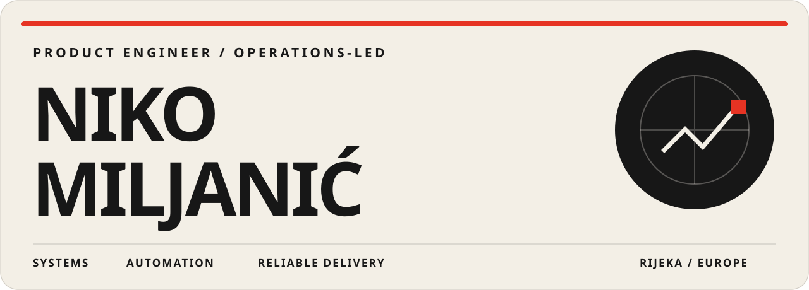
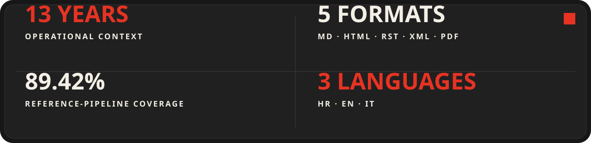
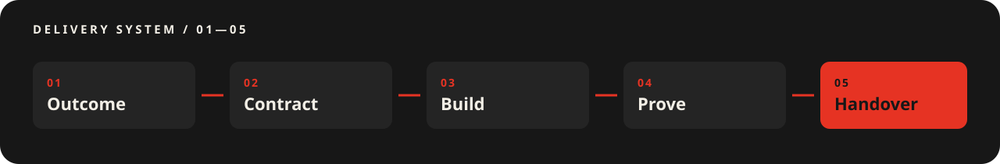

  

  <a href="https://ljemicus.vercel.app"><strong>Selected work ↗</strong></a>
  &nbsp;&nbsp;·&nbsp;&nbsp;
  <a href="https://www.linkedin.com/in/niko-miljani%C4%87-bab97929a"><strong>LinkedIn ↗</strong></a>
  &nbsp;&nbsp;·&nbsp;&nbsp;
  <a href="https://github.com/Ljemicus/document-migration-pipeline"><strong>Migration pipeline ↗</strong></a>

<h2 align="center">I turn messy operational workflows into shipped, testable systems.</h2>

  Thirteen years in client-facing operations taught me where software fails outside the demo. 
  I now use that experience to scope, build, verify, and hand over practical products.

 

  

 

## 01 / Selected systems

01.1 / PYTHON · DOCUMENT INFRASTRUCTURE

### [Document Migration Pipeline →](https://github.com/Ljemicus/document-migration-pipeline)

Deterministic conversion of Markdown, HTML, RST, XML, and PDF sources into GitBook-ready Markdown. The pipeline rewrites links, validates output, records content hashes, supports dry runs, and leaves machine-readable manifests and reports.

> **Evidence:** 9 tests · 89.42% coverage · Python 3.11–3.13 CI · Ruff · package build · gitleaks clean

 

01.2 / NEXT.JS · POSTGRESQL · PRODUCT

### [PetPark Marketplace →](https://github.com/Ljemicus/petpark-hr)

A Croatian pet-services marketplace with authentication, bookings, realtime messaging, responsive interfaces, and operational tooling. This is the primary product focus and the project moving toward real operation.

> **Product surface:** marketplace discovery · sitter workflows · booking flows · messaging · operational controls

 

01.3 / NEXT.JS · MARINA OPERATIONS · PRODUCT

### [MarinaFlow Launch Desk →](https://marinaflow-three.vercel.app/)

A fixture-backed operations desk that turns vessel readiness, incidents, ownership, and departures into a clear daily launch workflow across marina bases and desk dates.

> **Workflow proof:** readiness classification · incident triage · owner assignment · departure board · multi-base/day scenario controls

 

### Supporting builds

**[PetPark Mobile →](https://github.com/Ljemicus/petpark-mobile-hr)** — Expo and React Native companion application carrying the PetPark product language from web to mobile.

**[Midnight Consent Demo →](https://github.com/Ljemicus/midnight-consent-demo)** — Tested research implementation for exposing a verified fact without exposing its underlying private record; clearly bounded as a mock and Compact sketch, not production cryptography.

 

### Public application portfolio

**Operations & hospitality** — [MarinaFlow](https://github.com/Ljemicus/marinaflow) · [Hotel Fortunata](https://github.com/Ljemicus/hotel-fortunata-booking)

**Learning & daily practice** — [Učiteljica AI](https://github.com/Ljemicus/uciteljica-ai) · [Zora](https://github.com/Ljemicus/zora)

**Climate & connected systems** — [Solarna mjera](https://github.com/Ljemicus/solarna-mjera) · [Smart Hive Observatory](https://github.com/Ljemicus/smart-hive-observatory)

**Guided journeys & configuration** — [Dental Treatment Journey](https://github.com/Ljemicus/dental-treatment-journey) · [Forma 32](https://github.com/Ljemicus/forma-32)

 

## 02 / Operating range

**PRODUCT ENGINEERING** — `TypeScript` `React` `Next.js` `React Native`

**SYSTEMS & DATA** — `Python` `REST APIs` `Webhooks` `Supabase` `PostgreSQL`

**DELIVERY EVIDENCE** — `Pytest` `Vitest` `Playwright` `CI` `Dry runs` `Decision logs`

> I am most useful where the requirement is still ambiguous, the workflow crosses people and systems, and “works on my machine” is not a sufficient definition of done.

 

## 03 / How I deliver

  

**01 / Outcome** — define the real result and its failure conditions. 
**02 / Contract** — make boundaries, data, ownership, and acceptance explicit. 
**03 / Build** — complete the smallest useful path through UI, API, and data. 
**04 / Prove** — test behavior, edge cases, operational constraints, and release state. 
**05 / Handover** — leave decisions, evidence, and repeatable tooling behind.

 

## 04 / Working together

  <strong>Rijeka, Croatia · Remote across European time zones · Croatian / English / Italian</strong>

  For migration engineering, integrations, product delivery, or workflow automation, 
  start with the <a href="https://github.com/Ljemicus/document-migration-pipeline"><strong>document migration pipeline</strong></a>
  or connect on <a href="https://www.linkedin.com/in/niko-miljani%C4%87-bab97929a"><strong>LinkedIn</strong></a>.

